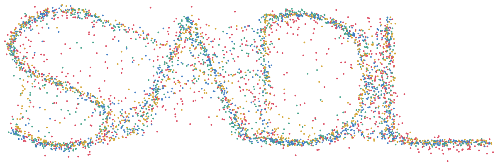
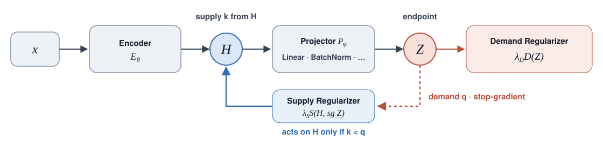
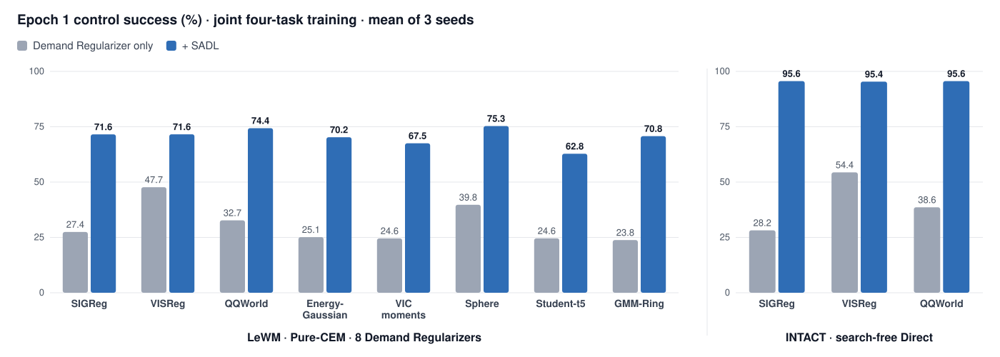
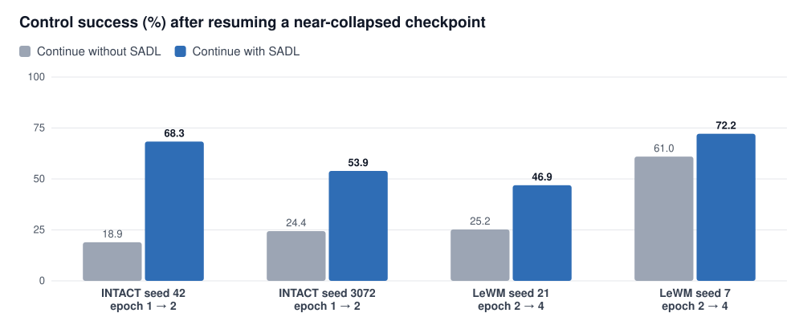
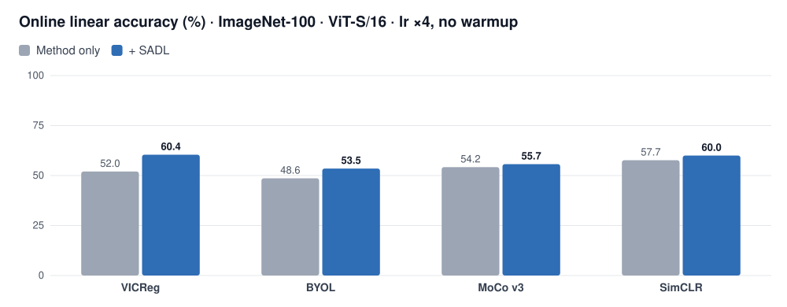

<div align="center">
  

  <h1>SADL: On the Demand-Supply Geometry of Representation Collapse</h1>

  <p>Official PyTorch implementation of <strong>Supply And Demand Loss (SADL)</strong>, with code to train and evaluate LeWM and INTACT world models.</p>

  <h3>No architecture changes &nbsp;&middot;&nbsp; No extra trainable parameters &nbsp;&middot;&nbsp; One hyperparameter</h3>
  <h3>High robustness &nbsp;&middot;&nbsp; High stability &nbsp;&middot;&nbsp; High success rate</h3>

  <p>
    <a href="https://github.com/DavidSunok">Junhan Sun</a><sup>1</sup>
    &nbsp;&middot;&nbsp; Yigui Feng<sup>2</sup>
    &nbsp;&middot;&nbsp; Mingzhe Liu<sup>2</sup>
    &nbsp;&middot;&nbsp; Haoyan Xu<sup>2</sup>
    &nbsp;&middot;&nbsp; Lei Ye<sup>2</sup>
    &nbsp;&middot;&nbsp; Ziqi Han<sup>2</sup>
    &nbsp;&middot;&nbsp; Hanru Bai<sup>3</sup>
    &nbsp;&middot;&nbsp; Yanzhao Zhang<sup>3</sup><br>
    Hao Zhao<sup>2,4,&dagger;</sup>
    &nbsp;&middot;&nbsp; Guofeng Zhang<sup>1,5,&dagger;</sup>
  </p>
  <p>
    <sup>1</sup>State Key Laboratory of CAD&amp;CG, Zhejiang University &nbsp;&middot;&nbsp; <sup>2</sup>RoboParty Lab &nbsp;&middot;&nbsp; <sup>3</sup>Alibaba Group<br>
    <sup>4</sup>AIR, Tsinghua University &nbsp;&middot;&nbsp; <sup>5</sup>InSpatio &nbsp;&middot;&nbsp; <sup>&dagger;</sup>Corresponding authors
  </p>

  <p>
    <a href="https://arxiv.org/abs/2611.21596"></a>
    <a href="https://zju3dv.github.io/SADL/"></a>
    <a href="https://huggingface.co/DavidSunok/SADL"></a>
    <a href="https://paperswithcode.co/paper/2611.21596#results"></a>
    <a href="#code"></a>
    <a href="https://zju3dv.github.io/SADL/#film"></a>
  </p>
  <p>
    <a href="#quick-start">Quick start</a> &nbsp;&middot;&nbsp;
    <a href="#why-sadl">Why SADL?</a> &nbsp;&middot;&nbsp;
    <a href="#method">Method</a> &nbsp;&middot;&nbsp;
    <a href="#results">Results</a> &nbsp;&middot;&nbsp;
    <a href="#citation">Citation</a>
  </p>
</div>

## News

- **[2026-11-19]** Released the [project page](https://zju3dv.github.io/SADL/) and project video.
- **[2026-11-16]** Released the [paper](https://arxiv.org/abs/2611.21596) on arXiv.
- Released the [INTACT and LeWM training and evaluation code](#code) and the [Hugging Face repository](https://huggingface.co/DavidSunok/SADL).

## Overview

<p align="center">
  
</p>
<p align="center">
  <a href="https://zju3dv.github.io/SADL/#film">Watch the 3-minute project video</a> &nbsp;&middot;&nbsp; <a href="https://zju3dv.github.io/SADL/">Open the interactive project page</a>
</p>

<a id="code"></a>

## Quick start

### Install

Start with Python 3.10 and a CUDA-enabled PyTorch installation.

```bash
git clone https://github.com/zju3dv/SADL.git
cd SADL
python -m pip install -r requirements.txt
```

For the optional fast encoder kernels on Hopper or Blackwell GPUs, run `python -m pip install -r requirements-fast.txt`.

### Evaluate a published checkpoint

This example runs the four-task INTACT model on Reacher using the Direct planner. It downloads the Reacher checkpoint and dataset, then runs a 10-episode check on one GPU.

```bash
hf download DavidSunok/SADL --include "checkpoints/intact/four_task/seed3072/reacher/*" --local-dir hf
hf download DavidSunok/SADL datasets/reacher.h5 --local-dir hf
python evaluate.py --checkpoint hf/checkpoints/intact/four_task/seed3072/reacher \
    --task reacher --data-dir hf/datasets --planner direct --seeds 0 --episodes 10
```

Omit `--seeds 0 --episodes 10` to run the published evaluation protocol of 100 episodes for each of seeds 0, 1, and 42.

### Train from scratch

On single-node RTX 5090 or 5090 D systems that report `illegal memory access` at the first NCCL collective, run `export NCCL_SAFE=1` before either training command below.

The training entry point uses four GPUs and a dataset manifest covering all four tasks. Download the HDF5 files once, then choose either training command.

```bash
hf download DavidSunok/SADL --include "datasets/*.h5" --local-dir hf
python tools/prepare_datasets.py --root hf/datasets --output datasets.json

# INTACT trained jointly on PushT, Cube, Reacher, and TwoRoom
python train.py --cell INTACT_4T_S3072 --gpus 0,1,2,3 --datasets datasets.json

# LeWM trained on PushT
python train.py --cell LEWM_PUSHT_S3072 --gpus 0,1,2,3 --datasets datasets.json
```

After training, pass the exported task directory to the evaluator.

```bash
python evaluate.py --checkpoint runs/INTACT_4T_S3072/exports/reacher \
    --task reacher --data-dir hf/datasets --planner direct
```

See the [training guide](docs/TRAINING.md) for all model and task combinations, hyperparameters, output files, and how to resume training.

## Why SADL?

In Joint-Embedding Predictive Architectures, **a well-regularized projector output does not by itself prevent representation collapse.**

- From initialization, the encoder representation $H$ is dominated by a component shared by all inputs: sample variation carries about 0.01% of its energy.
- A batch-normalized projector subtracts the batch mean. Moving all of $H$ along that shared direction leaves the endpoint $Z$ unchanged, so the Demand Regularizer and the task loss, both computed from $Z$, get zero gradient there.
- The remaining differences shrink until the representation collapses, while $Z$ can still look well-constrained.

SADL keeps the original objective and adds a **one-sided Supply Regularizer** on the encoder. It introduces no auxiliary networks, no trainable parameters and no architecture changes, and it works with any Demand Regularizer.

<p align="center">
  <strong>50% &rarr; 0%</strong> collapse rate over ten seeds &nbsp;&middot;&nbsp;
  <strong>3.4&ndash;6.4&times;</strong> encoder effective rank at epoch 1 &nbsp;&middot;&nbsp;
  <strong>&gt;95%</strong> search-free control
</p>

## Method

SADL reads a detached **demand capacity** $q$ from the endpoint, measures the **supply capacity** $k$ of the encoder, and corrects the encoder only when $k < q$:

$$
q=\sqrt{q_{\mathrm{reg}}\,q_{\mathrm{exc}}},\qquad
k=\min\{k_{\mathrm{exc}},\,k_{\mathrm{tr}}\},\qquad
\mathcal S=\big[\log(q+\epsilon)-\log(k+\epsilon)\big]_+^2 .
$$

$$
\mathcal L=\mathcal L_{\mathrm{task}}+\lambda_D\,\mathcal D(Z)+\lambda_S\,\mathcal S\big(H,\mathrm{sg}(Z)\big)
$$

$q_{\mathrm{reg}}$ rises as the Demand Regularizer is satisfied and $q_{\mathrm{exc}}$ measures sample variation in $Z$. $k_{\mathrm{exc}}$ scores the energy and spread of sample differences in $H$, and $k_{\mathrm{tr}}$ measures how much of them reaches $Z$ through regularized canonical correlations. The stop-gradient makes the correction act directly on $H$; the penalty is exactly zero once supply meets demand.

## World-model implementation

Training and evaluation code for JEPA world models trained on one or more control tasks with **one BatchNorm
population that does not depend on the GPU or the task**, for two objectives:

- **INTACT**: latent prediction and goal-conditioned action, evaluated with Direct and Guarded A planning;
- **LeWM**: latent prediction only, evaluated with CEM planning.

Both objectives use SIGReg on the projected embeddings and the SADL regularizer between encoder and projector
embeddings. Tasks: PushT, Cube, Reacher, TwoRoom.

### BatchNorm

- Every optimizer step uses a global batch of 256 windows of 8 frames. Windows are assigned to the BatchNorm
  population by their position in the global batch before they are split across GPUs; the projector and the
  prediction projector use one synchronized BatchNorm population over that batch. Multi-task batches are
  task-balanced (64 windows per task) and shuffled, so every normalization call sees all tasks.
- At inference all tasks use the same saved running statistics: no task-specific normalization, no statistics
  re-estimation and no task input. The task only selects the action dimension and the action scaling.
- One action encoder, predictor, prediction projector and (INTACT) actor are shared by all tasks.

### Repository

```
train.py            train one cell (4 GPUs)
evaluate.py         evaluate an exported checkpoint
docs/TRAINING.md    single-task and four-task training guide
tools/              dataset list
src/                training code; src/model: model, data, planners and configs; src/kernels: GPU operators
eval/               evaluation protocol: episode sampling, causal action history, planner settings
```

### Evaluation protocol

`--planner direct` or `guarded_a` for INTACT checkpoints, `cem` for LeWM checkpoints. Start states and goals are
sampled from dataset episodes with the goal 25 steps ahead; the agent has at most 50 actions, plans 5 action blocks
ahead and replans every 5 actions; INTACT receives the causal history of the previous 5 actions; the model runs in
FP32 with solver batch size 1. By default `evaluate.py` runs seeds 0, 1 and 42 with 100 episodes each. Reported
results were computed on an NVIDIA RTX 4090.

| Planner | Candidates |
|---|---|
| `direct` | none: the actor's action plan |
| `guarded_a` | 128 samples x 3 iterations around the Direct plan, top 16, initial std 0.25 |
| `cem` | 300 samples x 30 iterations, top 30, initial std 1.0 |

### Checkpoints and datasets

Checkpoints for the [shared BatchNorm results](#shared-batchnorm-results) and the four HDF5 datasets are available from [DavidSunok/SADL on Hugging Face](https://huggingface.co/DavidSunok/SADL) under
`checkpoints/<intact|lewm>/<four_task|single_task>/seed<seed>/<task>/` (`weights_epoch_1.pt`, `config.yaml`,
`action_stats.json`, `training_config.json`) and `datasets/`. Pass a task folder to `evaluate.py` as `--checkpoint`
and the dataset folder as `--data-dir`. The four task folders of a four-task model share all weights and
normalization statistics.

## Results

### Epoch 1: every Demand Regularizer lifts together

<p align="center">
  
</p>

Gaussian or not, the encoder keeps up with what is demanded: with SADL, LeWM reaches 62.8&ndash;75.3% after one epoch under all eight Demand Regularizers (from 23.8&ndash;47.7%), and INTACT reaches 95.4&ndash;95.6% search-free success (from 28.2&ndash;54.4%). Mean over three training seeds.

### Repairing collapsed encoders

<p align="center">
  
</p>

SADL can also reopen an encoder that has already collapsed. Resuming from fixed near-collapsed checkpoints with SADL at its default weight $\lambda_S=0.01$, INTACT recovers from 18.9% to 68.3% within one more epoch.

### Mainstream SSL

<p align="center">
  
</p>

SADL is a drop-in addition to standard self-supervised objectives. On ImageNet-100 with ViT-S/16, under a learning rate &times;4 and no warmup, it lifts VICReg by 8.4 points and BYOL by 4.9 points of online linear accuracy, with no other change to the recipe.

### Image classification

On ImageNet-LT, Galaxy10, CIFAR-10 and Imagenette, SADL improves early learning; on Imagenette it reaches the baseline's final accuracy with 23% fewer updates. Interactive curves are on the [project page](https://zju3dv.github.io/SADL/#images).

### Shared BatchNorm results

Success rate (%), mean +- SD over training seeds 3072 / 3073 / 3074 (each seed: 300 episodes).

| Model | Training | Planner | PushT | Cube | Reacher | TwoRoom | Mean |
|---|---|---|---|---|---|---|---|
| INTACT | four tasks | Direct | 85.7 +- 0.9 | 100.0 +- 0.0 | 93.4 +- 1.7 | 100.0 +- 0.0 | 94.8 +- 0.4 |
| INTACT | four tasks | Guarded A | 88.1 +- 0.8 | 99.6 +- 0.4 | 93.1 +- 0.7 | 99.8 +- 0.4 | 95.1 +- 0.3 |
| INTACT | single task | Direct | 85.1 +- 0.4 | 100.0 +- 0.0 | 94.9 +- 2.0 | 99.7 +- 0.6 | 94.9 +- 0.5 |
| INTACT | single task | Guarded A | 89.8 +- 0.2 | 99.6 +- 0.2 | 93.7 +- 3.2 | 99.3 +- 0.9 | 95.6 +- 0.9 |
| LeWM | four tasks | CEM | 64.7 +- 18.5 | 59.6 +- 1.3 | 46.7 +- 26.1 | 94.4 +- 1.0 | 66.3 +- 9.2 |
| LeWM | single task | CEM | 83.1 +- 1.6 | 58.9 +- 1.4 | 81.0 +- 4.3 | 91.3 +- 1.5 | 78.6 +- 1.9 |

Per-seed values are in [RESULTS.md](RESULTS.md).

## License

MIT, see [LICENSE](LICENSE). Parts of `src/model` derive from LeWM; see [NOTICE.md](NOTICE.md).

## Citation

```bibtex
@article{sun2026sadl,
  title   = {{SADL}: On the Demand-Supply Geometry of Representation Collapse},
  author  = {Sun, Junhan and Feng, Yigui and Liu, Mingzhe and Xu, Haoyan and
             Ye, Lei and Han, Ziqi and Bai, Hanru and Zhang, Yanzhao and
             Zhao, Hao and Zhang, Guofeng},
  journal = {arXiv preprint arXiv:2611.21596},
  year    = {2026}
}
```
